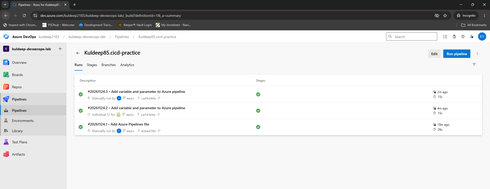

# Day 24 — Azure DevOps: a pipeline in your own personal organisation

**Week 5 · about 60 minutes · Run in: Browser (dev.azure.com) + Ubuntu terminal**

## Why this matters
You know Azure DevOps from work. Today you build one from scratch in your own organisation, so you can show and explain a pipeline you created end to end.

## Goal today
Create a personal Azure DevOps organisation and project, connect your GitHub repo, and run your first YAML pipeline.

## Commands you will learn

| Command | What it does |
|---|---|
| `Pipelines → New pipeline` | create a pipeline from a YAML file |
| `azure-pipelines.yml` | default file name in the repo root |
| `Variables / Parameters` | values you can change per run |
| `pool: vmImage / name` | hosted agent vs your own agent |
| `Project settings → Service connections` | how pipelines reach GitHub or Azure |

## Do this (run each block, then read the output before moving on)
**Important:** use a **personal** Microsoft account and a **new** organisation. Do not use your work organisation (`naviamio`) or any client project for practice.

1. Go to `dev.azure.com`, sign in with a personal Microsoft account, create an organisation and a project called `cicd-practice`.
2. **Request free build minutes:** new organisations often have no Microsoft-hosted agents. Submit the form at `https://aka.ms/azpipelines-parallelism-request` (allow several business days). While waiting, use a self-hosted agent (step 5).
3. In your GitHub `cicd-practice` repo add this file:

```bash
cd ~/repos/cicd-practice
cat > azure-pipelines.yml <<'EOF'
trigger:
  branches:
    include: [main]

pool:
  vmImage: ubuntu-latest

steps:
  - script: |
      echo "Build $(Build.BuildId) on branch $(Build.SourceBranchName)"
      node --version
    displayName: Show build info
EOF
git add . && git commit -m "Add Azure Pipelines file" && git push
```

4. In Azure DevOps: **Pipelines → New pipeline → GitHub → select your repo → Existing Azure Pipelines YAML file → `/azure-pipelines.yml` → Run.**
5. *If you have no hosted agent yet:* **Project settings → Agent pools → Default → New agent → Linux**, then follow the shown commands inside Ubuntu (`tar`, `./config.sh`, `./run.sh`). Change the file to `pool: name: Default` and run again.

## What you should see
A run appears with your `echo` output including the build ID and branch name. If it says `No hosted parallelism has been purchased or granted`, that is the free-grant issue: use the self-hosted agent.

## Your exercise (type it yourself, don't copy)
1. Add a variable `greeting: Hello` at the top level and print it with `$(greeting)`.
2. Add a `parameters:` boolean and use it in a step condition (`condition: eq('${{ parameters.flag }}', 'true')`).
3. Compare this file with the GitHub Actions `hello.yml`: list three differences in syntax.

## Save your evidence
Copy the file to `labs/day-24/azure-pipelines.yml`. 

parameters:
  - name: flag
    displayName: Run the extra step?
    type: boolean
    default: false

trigger:
  branches:
    include: [main]

variables:
  greeting: Hello

pool:
  name: Default

steps:
  - script: |
      echo "Build $(Build.BuildId) on branch $(Build.SourceBranchName)"
      node --version || echo "node is not installed on this agent"
    displayName: Show build info
  - script: echo "$(greeting) from Azure Pipelines"
    displayName: Print greeting
  - script: echo "flag is on"
    displayName: Flag step
    condition: eq('${{ parameters.flag }}', 'true')

Put a screenshot of your green **personal-org** run in `labs/day-24/run.png` (check it shows no work or client information).




Then commit and push (from the training repo):

```bash
cd ~/repos/devsecops-training-log
tools/finish-day.sh 24 "azure devops personal pipeline"
```

## My notes (fill in before you commit)
- Commands I ran: created a personal Azure DevOps organisation and project, created a short-lived PAT with Agent Pools (Read & manage), downloaded and ran a self-hosted agent (config.sh, run.sh), added azure-pipelines.yml to my GitHub repo, created the pipeline from the existing YAML file, then added a variable and a boolean parameter with a condition.

- What I learned: A new organisation has no Microsoft-hosted agents until Microsoft approves a request, so I used a self-hosted agent on my own Ubuntu, which only works while run.sh is running. The PAT is only needed to register the agent, so I revoked it afterwards. The pipeline needs permission to use the agent pool. A condition skips a step. Three differences from GitHub Actions: [your three].

- What went wrong and how I fixed it: I first clicked the Azure free trial by mistake (Get started with Azure); I went to dev.azure.com directly instead and did not sign up for anything or enter a card.
